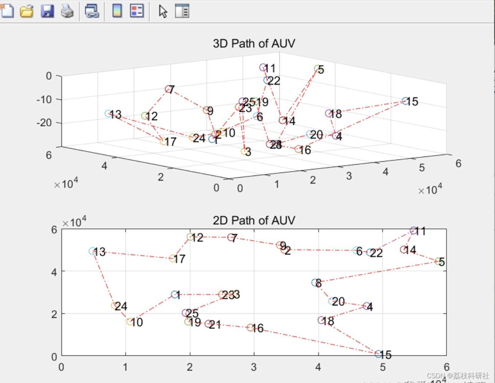
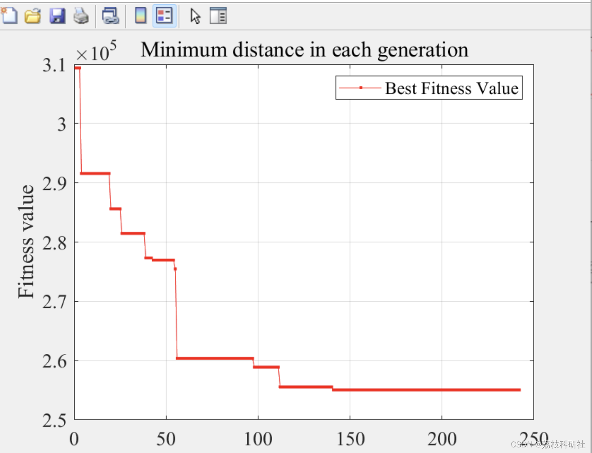

# [Z] Path Planning Problem for Autonomous Underwater Vehicle Based on Genetic Algorithm (Matlab Code Implementation)

Application of Genetic Algorithm (GA) to the global path planning problem of AUV in large-scale marine environments. The paper introduces the grid-based environmental model and its data structure, and through simulation results, it can be seen that: GA adopts a variable-length encoding method to make the path description simple and clear, with fast convergence speed and high efficiency in solving practical problems, meeting the real-time requirements of the system.
📚2 Run Results Edit
Edit:
Part of the code:
Fitconst=0; %Number of generations that fitness values remain constant
%% Genetic algorithm
while(Generation <= ITERATION)
if (Fitconst<=THRESHOLD) %Stop iteration if fitness value is constant in threshold number of generations
fitness = Fitness(Parentpop,adjacency); %Calculate fitness of parents
crossover = Crossover(Parentpop,Pcross); %Crossover
Childpop = Mutation(crossover,Pmutation); %Mutate and get children
combopop=[Parentpop;Childpop]; %Combine parents and children
combofitness=Fitness(combopop,adjacency);   %Calculate overall fitness  
nextpop=Select(combopop,combofitness);    %Select the first half of best to get 2nd gen  
Parentpop=nextpop.pop;  
if(Generation ==1)  
Best_GApath=Parentpop(1,:);  
Best_Fitness=combofitness(nextpop.bestplan);  
else  
New_Best_Fitness=combofitness(nextpop.bestplan);%Evaluate best solution  
New_Best_GApath=Parentpop(1,:);  
if(New_Best_Fitness<Best_Fitness)  
Best_Fitness=New_Best_Fitness;  
Best_GApath=New_Best_GApath;  
Fitconst = 0;  
%%%%%%%%Visualize planning process%%%%%%%%  
%          GENERATION=[1:Generation-1];  
%          GAplancoor = [RP(Best_GApath).x;RP(Best_GApath).y; RP(Best_GApath).z].';  
%          figure(1);  
%          for i=1:RPNUM  
%            subplot(2,1,1);  %Plot all rendezvous points  
%            plot3(RP(i).x,RP(i).y,RP(i).z,'o');  
%            text(RP(i).x,RP(i).y, RP(i).z,num2str(i));  
%            hold on;  
%            subplot(2,1,2);  
%            plot(RP(i).x,RP(i).y,'o');  
%            text(RP(i).x,RP(i).y,num2str(i));  
%            hold on;  
%          end  
%          subplot(2,1,1);  
%          plot3(GAplancoor(:,1),GAplancoor(:,2),GAplancoor(:,3),'r-.');  
%          title('3D Path of AUV');  
%          grid on;  
%          hold off;  
%          subplot(2,1,2);  
%          plot(GAplancoor(:,1),GAplancoor(:,2),'r-.');  
% Title('2D Path of AUV');
% grid on;
% hold off;
% %%%%%%%% Visualize planning process%%%%%%%%
else
Fitconst = Fitconst + 1;
end
end
🎉3 References
🌈4 Matlab Code Implementation

## Images

<!-- PAYMENT_BLOCK -->

## Get this dataset

- Payment link (Stripe): [Buy now](https://buy.stripe.com/3cs8yP7sY87d0vu9AB)
- Payment QR code: 

<!-- /PAYMENT_BLOCK -->
